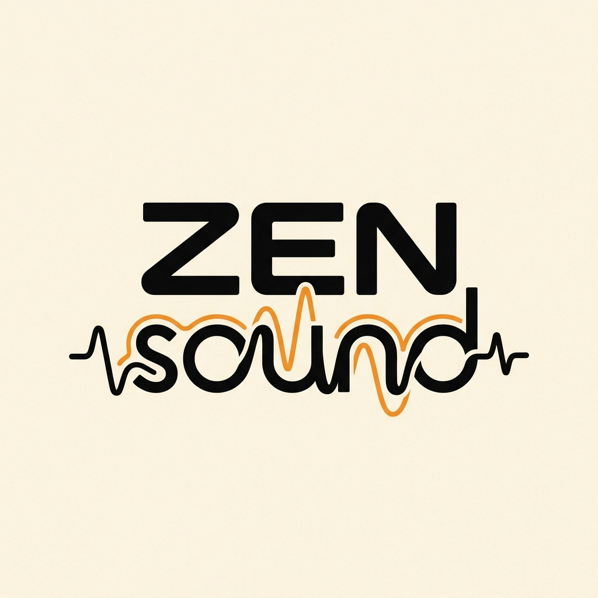

<div align="center">
  

  #   Zen Sound

  **Минималистичный ретро-плеер для души.**<br>
  Чистый звук, изолированные стриминговые хабы, самохостинг и раздельный офлайн-кэш без лишнего мусора и раздутого софта.

  [](#дизайн-и-темы)
  [](#философия-легкости)
  [](LICENSE)
</div>

---

## 🎯 Манифест проекта

Современные музыкальные сервисы (Spotify, Яндекс Музыка и др.) превратились в неповоротливых монстров на Electron, потребляющих сотни мегабайт оперативной памяти ради воспроизведения 3-мегабайтного аудиофайла. Они перегружены рекламой, тяжелыми анимациями, ненужными социальными функциями и внешними базами данных.

**Zen Sound** возвращает удовольствие от прослушивания музыки:
1. **Только музыка**: Никаких сторонних парсеров, караоке, соцсетей и рекомендательного спама.
2. **Изолированные хабы сервисов**: Яндекс Музыка, Spotify, VK Музыка и Домашний сервер живут в отдельных изолированных разделах и никогда не смешиваются в общую кашу.
3. **Раздельный офлайн-кэш**: Скачивайте треки в память конкретного сервиса. Очистка кэша одного сервиса не затрагивает другие.
4. **Тактильный ретро-дизайн**: Вдохновлен винтажной аппаратурой Braun 80-х, Teenage Engineering и кассетными плеерами.
5. **Поддержка сторонних скинов**: Полностью кастомизируемый интерфейс через простые JSON-файлы тем.
6. **Самохостинг (Self-hosted)**: Прямая работа с личными серверами через стандартный Subsonic API с возможностью удаленного защищенного подключения.

---

## 🎨 Дизайн и Форм-факторы

Интерфейс Zen Sound поддерживает несколько режимов отображения:
* **📱 Портативный карманный (Handheld)**: Вертикальный ретро-гаджет для смартфонов и компактного режима на ПК с большими физическими кнопками и аналоговым ползунком.
* **🖥️ Десктоп-виджет (Mini)**: Горизонтальный компактный виджет, который можно закрепить поверх рабочих окон.
* **📼 Медиатека ПК (Full)**: Расширенный интерфейс со спартанским списком треков и кассетным шармом.

### Скины (Темы)
Темы описываются в простых JSON-файлах в папке `themes/`:
* `braun-80s.json` — классический теплый кремовый корпус с оранжевым шасси.
* `cyberdeck.json` — терминальный темно-зеленый стиль.
* `gameboy.json` — ностальгический оливково-серый ретро-экран.
* `industrial.json` — строгий черно-желтый технический стиль.

---

## 📂 Структура репозитория

```
zen-sound/
├── assets/               # Фирменные логотипы и графические материалы
│   ├── logo.jpg
│   └── logo-variations.jpg
├── docs/                 # Архитектурная документация и спецификации
│   └── ARCHITECTURE.md   # Устройство аудиодвижка, кэша и плагинов
├── themes/               # Коллекция официальных и пользовательских скинов
│   ├── braun-80s.json
│   └── cyberdeck.json
├── web-prototype/        # Интерактивные прототипы UI
│   ├── index.html
│   └── concept1_refined.html
├── src/                  # Исходный код приложения
├── config.example.toml   # Базовый конфигурационный файл
├── .gitignore
├── LICENSE               # All Rights Reserved
└── README.md
```

---

## 🗺️ Дорожная карта (Roadmap)

- [x] Концепция и интерактивный прототип интерфейса.
- [x] Фирменный стиль и официальный логотип (ZEN + непрерывная волна sound).
- [x] Архитектура изолированных хабов и раздельного кэша.
- [ ] Базовый каркас кроссплатформенного приложения (десктоп + мобильные).
- [ ] Нативный аудиодвижок (аппаратное декодирование FLAC, MP3, OPUS).
- [ ] Модуль подключения Домашнего сервера (Subsonic API).
- [ ] Модуль Яндекс Музыки («Моя волна», «Мне нравится»).
- [ ] Модуль Spotify & VK Музыки.
- [ ] Офлайн-кэширование в изолированные хранилища.
- [ ] Загрузчик пользовательских скинов/тем из каталога.

---

## 📄 Лицензия

Copyright (c) 2026 keks84725. Все права защищены. Подробнее см. в [LICENSE](LICENSE).
